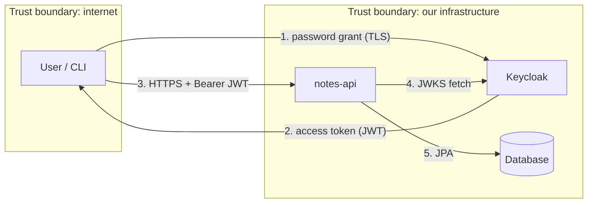

# Threat model: notes API (STRIDE)

Status: **draft**. One threat is worked as an example. The rows marked TODO are yours to write.
Use AI as a reviewer, not as the author: write your version first, then ask it what you missed.

## 1. What we are building

A multi-tenant API where users keep private notes. Users log in with Keycloak (OIDC) and call the API
with a bearer access token. Each note belongs to one user inside one tenant (a gym).

## 2. Data flow and trust boundaries

Assets: note contents (confidential), user identity, tenant isolation, signing keys in Keycloak.

## 3. Threats

| # | Element | STRIDE | Threat | Likelihood / Impact | Mitigation | Evidence |
|---|---|---|---|---|---|---|
| T1 | API `GET /api/notes/{id}` | Information disclosure, Elevation of privilege | **BOLA**: a user guesses another note id and reads it, inside or across tenants | High / High | Every lookup is scoped by id + tenant + owner from the verified token. Unknown or foreign ids return 404 so existence is not leaked | SR-01, `NoteAccessTest.sr01_*` |
| T2 | API | Spoofing | TODO: forged or expired JWT accepted | | | |
| T3 | API `POST /api/notes` | Tampering | TODO: client sets `ownerId` or `tenant` in the body | | | |
| T4 | Token | Spoofing | TODO: token without a tenant claim falls back to a default tenant | | | |
| T5 | API | Denial of service | TODO: huge payloads or request floods | | | |
| T6 | Errors | Information disclosure | TODO: stack traces or SQL errors in responses | | | |
| T7 | Pipeline | Tampering | TODO: a malicious dependency or leaked secret gets into the build | | | |
| T8 | Keycloak | Repudiation | TODO: no audit trail of who did what | | | |

## 4. Open questions and accepted risks

- TODO: what is out of scope (e.g. Keycloak hardening, network layer) and why?
- TODO: which risks do you accept for now, and who signs off?

## 5. How to keep it alive

Review this file in every pull request that adds an endpoint, a data store or a new trust boundary.
